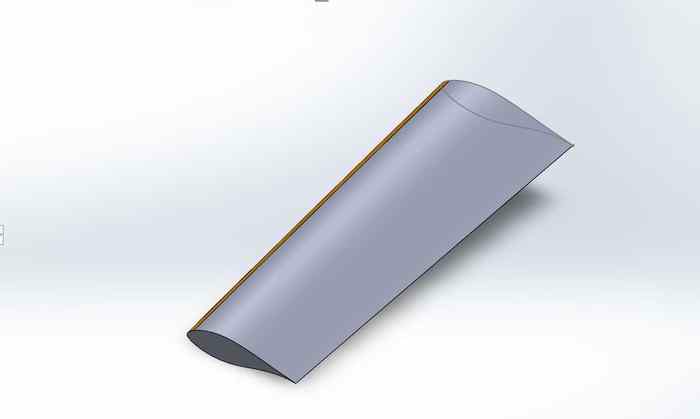
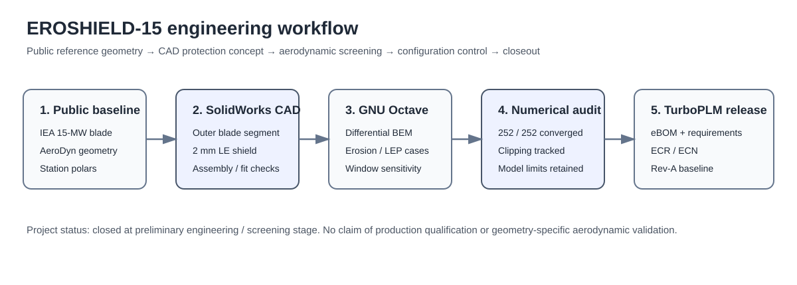
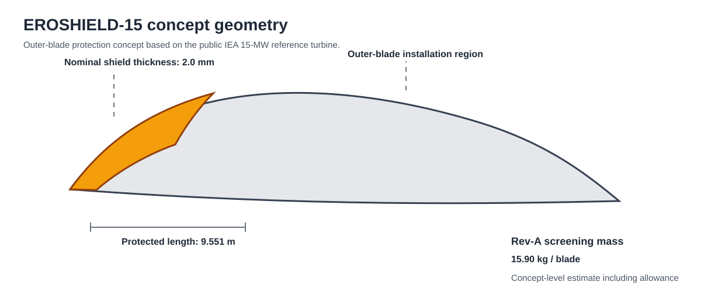
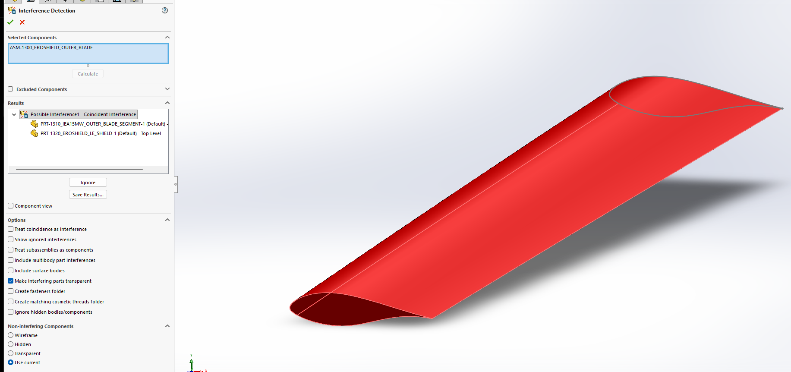
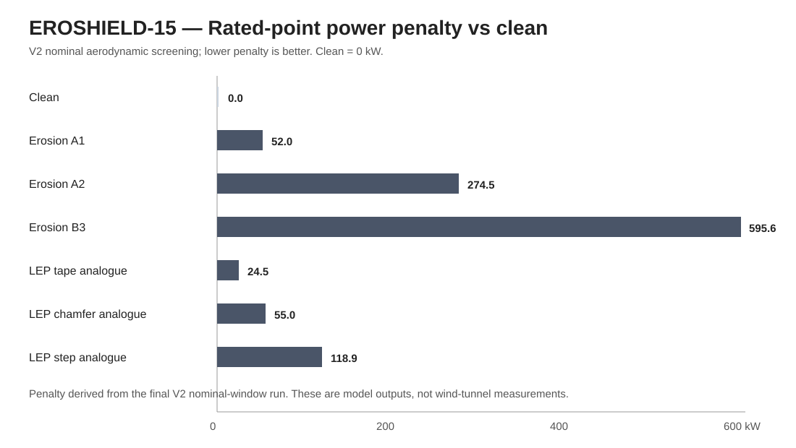
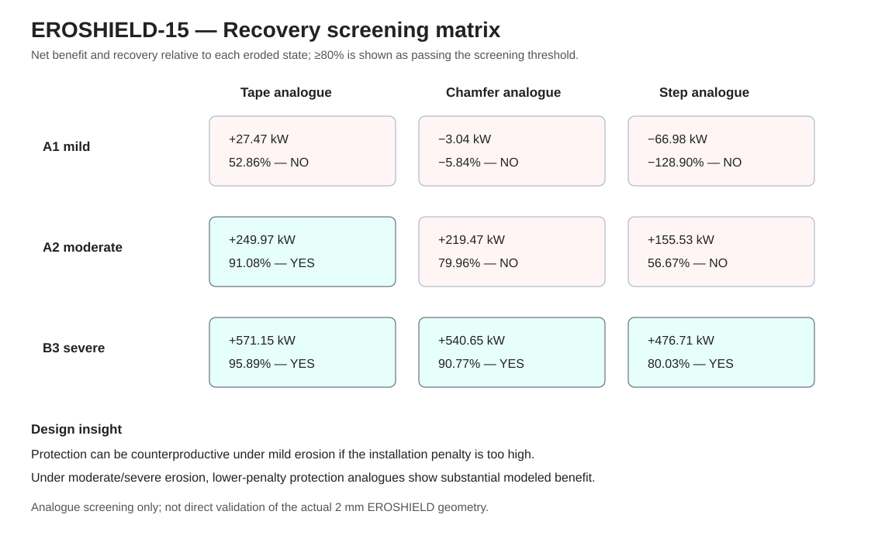
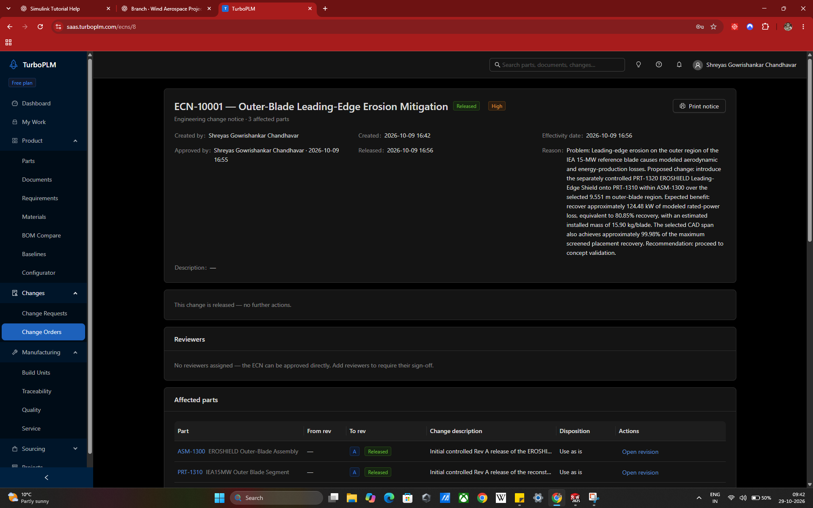

# EROSHIELD-15

**Preliminary leading-edge erosion protection and aerodynamic trade study for the public IEA 15-MW reference wind turbine**

<p align="center">
  
</p>

<p align="center"><i>Actual SolidWorks assembly view: grey IEA 15-MW outer-blade segment with the orange EROSHIELD leading-edge protection component.</i></p>

## Project objective

EROSHIELD-15 investigates whether a separately controlled, removable/conformal leading-edge protection concept can reduce the aerodynamic consequences of outer-blade erosion while keeping the protection penalty, added mass, placement and attachment loads within a defensible concept-level envelope.

The study combines **SolidWorks CAD, GNU Octave differential BEM analysis, numerical verification, engineering trade studies and TurboPLM configuration control**. It is intentionally closed at the **preliminary engineering / screening stage** and is not presented as a certified or production-ready LEP system.



---

## 1. Engineering problem

Leading-edge erosion can reduce lift-to-drag ratio and increase aerodynamic losses in the high-speed outer region of a wind-turbine blade. However, a protection system is not aerodynamically free: thickness, surface discontinuity and termination geometry can also introduce losses.

The engineering question therefore became:

> **Can a leading-edge protection concept provide a net benefit once the aerodynamic penalty of the protection itself, added mass, spanwise placement and attachment implications are included?**

That distinction drove the project away from a single assumed “recovery percentage” and toward a condition-dependent trade study.

---

## 2. Controlled CAD concept

The Rev-A configuration uses the public **IEA 15-MW reference blade** as the geometric baseline.

| Parameter | Rev-A controlled value |
|---|---:|
| Protected physical span | **9.551 m** |
| Nominal shield thickness | **2.0 mm** |
| CAD thickness check | ~1.98 mm |
| Installed-mass screening estimate | **15.90 kg/blade** |
| Outer-blade object | `PRT-1310` |
| Protection component | `PRT-1320` |
| Assembly | `ASM-1300` |

The protection was modeled as a **separate component** rather than permanently modifying the reference blade. This supports replaceability, independent revision control and assembly-level configuration management.



### SolidWorks work completed

- reconstructed the selected IEA 15-MW outer-blade segment;
- generated the conformal leading-edge shield component;
- built the blade + shield assembly;
- checked geometric registration and fit;
- reviewed the shield/blade coincidence in SolidWorks Interference Detection;
- retained the shield as an independently controlled Rev-A part.

The proposed later feathered/scarf termination redesign was **not completed** before project closeout, so the released Rev-A geometry remains the final controlled CAD baseline.

---

## 3. CAD verification evidence

<p align="center">
  
</p>

<p align="center"><i>Actual SolidWorks Interference Detection screenshot. The reported condition is the intended coincident interface between PRT-1310 and PRT-1320 and was reviewed during assembly fit checking.</i></p>

This verification was used as **CAD integration evidence**, not as structural qualification. Final adhesive peel, local debond, fatigue and rain-erosion behavior were outside the completed scope.

---

## 4. Aerodynamic screening methodology

The rotor study used a **differential outer-segment BEM correction** anchored to the project clean rated-power baseline:

[
P_{total}=P_{baseline}+left(P_{segment,case}-P_{segment,clean}
ight)
]

Key rated-point model inputs included:

- air density: 1.225 kg/m³;
- wind speed: 10.59 m/s;
- rotor speed: 7.56 rpm;
- three blades;
- public IEA outer-blade geometry;
- station-specific AeroDyn polar data;
- Prandtl hub/tip losses;
- bounded induction factors;
- relaxation-based convergence.

### Rev-A parametric screening

The original controlled Rev-A model used:

- erosion: **−5% (C_L), +50% (C_D)**;
- protection: prescribed **80% sectional coefficient-penalty recovery**.

It produced approximately:

| Metric | Rev-A result |
|---|---:|
| Clean power | 16.204 MW |
| Eroded power | ~16.050 MW |
| EROSHIELD power | ~16.174 MW |
| Modeled recovered rated power | **124.48 kW** |
| Rotor-level recovery | **80.85%** |
| Recovered AEP proxy | **0.5828 GWh/year** |

These remain **historical Rev-A screening results under explicit assumptions**. The AEP value is a rated-point proportional proxy, not a full wind-distribution/power-curve integration.

### V2 literature-informed screening

The later V2 analysis removed the forced 80% recovery outcome and independently crossed erosion states with LEP analogue penalties:

- Clean
- Erosion A1
- Erosion A2
- Erosion B3
- LEP tape analogue
- LEP chamfer analogue
- LEP step analogue

The tape/chamfer/step branches are **analogue sensitivity cases**, not measurements of the actual 2 mm EROSHIELD geometry.

---

## 5. Final V2 rated-point results



| Case | Rotor power [MW] | Change vs clean [kW] |
|---|---:|---:|
| Clean | 16.204000 | 0.00 |
| Erosion A1 | 16.152040 | −51.96 |
| Erosion A2 | 15.929537 | −274.46 |
| Erosion B3 | 15.608354 | −595.65 |
| LEP tape analogue | 16.179509 | −24.49 |
| LEP chamfer analogue | 16.149004 | −55.00 |
| LEP step analogue | 16.085062 | −118.94 |



| Erosion state | LEP analogue | Net benefit [kW] | Recovery |
|---|---|---:|---:|
| A1 mild | Tape | +27.47 | 52.86% |
| A1 mild | Chamfer | −3.04 | −5.84% |
| A1 mild | Step | −66.98 | −128.90% |
| A2 moderate | Tape | +249.97 | 91.08% |
| A2 moderate | Chamfer | +219.47 | 79.96% |
| A2 moderate | Step | +155.53 | 56.67% |
| B3 severe | Tape | +571.15 | 95.89% |
| B3 severe | Chamfer | +540.65 | 90.77% |
| B3 severe | Step | +476.71 | 80.03% |

### Main design insight

> **Protection is condition-dependent. A protection system can be counterproductive under mild erosion if its own installation penalty is too high, while low-penalty protection can provide substantial modeled benefit under moderate/severe erosion.**

This is the key engineering conclusion of EROSHIELD-15.

---

## 6. Numerical audit

The V2 model was solved for three angle-of-attack transfer windows:

- Nominal: ([0,4,9,13]^circ)
- Wide: ([0,3,10,14]^circ)
- Narrow: ([3,6,7,10]^circ)

Across 3 windows × 7 aerodynamic states × 12 stations:

| Diagnostic | Result |
|---|---:|
| Converged solutions | **252 / 252** |
| Maximum iterations | **76 / 200** |
| Axial-induction clip flags | **21** |
| Tangential-induction clip flags | **0** |
| Convergence status | **PASS** |
| Induction clipping | **REVIEW REQUIRED** |

The clipping flags are preserved as a numerical limitation because the model uses bounded induction without a dedicated high-induction correction.

---

## 7. Span-placement decision

A fixed **9.551 m** protection window was swept across the outer blade. With the station-specific outer-blade polar model, the existing CAD location captured approximately:

[
oxed{99.98%}
]

of the maximum recovered power among the tested fixed-length candidates.

The modeled benefit of relocating the shield was only about **0.034 kW**, so the engineering decision was to **retain the existing CAD span**.

---

## 8. Mass and attachment screening

| Quantity | Screening result |
|---|---:|
| TPU shell mass | 14.46 kg/blade |
| Installed mass incl. allowance | **15.90 kg/blade** |
| Approx. fraction of reference blade mass | 0.0244% |
| Radial mass centroid | 107.89 m |
| Rated centrifugal load | ~1.075 kN/blade |
| Average centrifugal bond shear | ~0.167 kPa |
| Factored average shear, FoS = 3 | ~0.500 kPa |

The conclusion was **not** that the attachment was fully qualified. The result only showed that uniform average centrifugal shear was unlikely to be the dominant concept-level risk.

Higher-priority unresolved risks remain:

- edge peel;
- local debond initiation;
- cyclic blade flexure;
- rain/particle impact;
- thermal mismatch;
- moisture ingress;
- adhesive ageing/fatigue.

---

## 9. TurboPLM requirements and traceability

EROSHIELD-15 was managed as a small configuration-controlled product-development study in **TurboPLM**, not only as loose CAD and analysis files.

<p align="center">
  
</p>

<p align="center"><i>Actual TurboPLM requirements page showing the six approved Rev-A requirements.</i></p>

### Exact approved requirements

| Requirement | Title | Type | Priority | Status |
|---|---|---|---|---|
| REQ-10001 | EROSHIELD Leading-Edge Protection Concept | Functional | High | Approved |
| REQ-10002 | Modeled Aerodynamic Loss Recovery | Functional | High | Approved |
| REQ-10003 | Installed Shield Mass Limit | Performance | High | Approved |
| REQ-10004 | Outer-Blade Protection Coverage | Functional | High | Approved |
| REQ-10005 | Replaceable Protection Architecture | Functional | Medium | Approved |
| REQ-10006 | Protection Span Placement Efficiency | Performance | Medium | Approved |

**Release coverage:** 6 approved / 6 covered / 0 uncovered.

---

## 10. PLM change-control release


The controlled workflow included:

- `REF-0001` — IEA 15-MW Reference Blade
- `PRT-1310` — IEA15MW Outer Blade Segment — **Rev A Released**
- `PRT-1320` — EROSHIELD Leading-Edge Shield — **Rev A Released**
- `ASM-1300` — EROSHIELD Outer-Blade Assembly — **Rev A Released**
- `DOC-2000` — Source and License Record
- `DOC-2100` — Aerodynamic & Rotor Impact Analysis — Rev A
- `ECR-10001` — Outer-Blade Leading-Edge Erosion Mitigation — **Accepted**
- `ECN-10001` — Outer-Blade Leading-Edge Erosion Mitigation — **Released**

<p align="center">
  
</p>

<p align="center"><i>Actual TurboPLM ECN-10001 release page showing the three affected Rev-A parts and the released change notice.</i></p>

The ECN release retained the Rev-A screening basis: **124.48 kW modeled rated-power recovery, 80.85% modeled recovery, 15.90 kg/blade installed-mass estimate and ~99.98% screened placement efficiency**. These are configuration-controlled historical Rev-A values, not experimental validation claims.

The original TurboPLM database remains the authoritative PLM record; this GitHub repository mirrors the configuration logic and supporting evidence for portfolio review.

---

## 11. CFD disposition

A lightweight SU2 branch was attempted for direct AF45 erosion-delta prediction. Some runs converged numerically but produced nonphysical force behavior, including negative drag.

Those results were therefore **rejected** and are not used as validation evidence or headline project results.

This is documented in `rejected-cfd/`.

---

## 12. What was intentionally not completed

The project was closed before production qualification.

Not completed:

- Phase-12 feathered/scarf termination redesign;
- geometry-specific CFD validation of the actual 2 mm shield;
- wind-tunnel validation;
- adhesive peel/fracture testing;
- structural FEA of the final attachment;
- rain-erosion qualification;
- thermal/environmental ageing;
- blade-flexure compatibility testing;
- full power-curve/wind-distribution AEP integration;
- manufacturing-process qualification.

These are documented as **open validation gates**, not hidden gaps.

---

## 13. Repository structure

```text
EROSHIELD-15/
├── analysis/
│   └── EROSHIELD15_literature_screening_v2.m
├── data/
│   └── README.md
├── results/
│   ├── EROSHIELD15_revA_final_results.csv
│   ├── EROSHIELD15_v2_nominal_summary.csv
│   ├── EROSHIELD15_v2_nominal_comparisons.csv
│   └── EROSHIELD15_v2_numerical_audit.txt
├── docs/
│   └── DOC-2000_Source_and_License_Record.txt
├── plm/
│   ├── README.md
│   ├── CHANGE_CONTROL.md
│   ├── EBOM.md
│   ├── REQUIREMENTS_STATUS.md
│   └── RELEASE_BASELINE.md
├── cad-reference/
│   └── README.md
├── rejected-cfd/
│   └── README.md
├── images/
│   ├── cad_assembly_hero_actual.svg
│   ├── cad_interference_check_actual.svg
│   ├── plm_requirements_actual.svg
│   ├── plm_ecn_released_actual.svg
│   ├── geometry_summary.svg
│   ├── project_workflow.svg
│   ├── v2_power_penalty.svg
│   ├── v2_recovery_matrix.svg
│   └── plm_traceability.svg
├── PROJECT_CLOSEOUT.md
└── THIRD_PARTY_NOTICE.md
```

---

## 14. Skills demonstrated

**Mechanical design / CAD**
- SolidWorks part and assembly modelling
- conformal component concept development
- assembly fit/interference review
- controlled CAD object structure

**Aerodynamics / numerical engineering**
- GNU Octave
- blade-element momentum modelling
- public AeroDyn polar handling
- sensitivity analysis
- numerical convergence diagnostics

**Engineering process / PLM**
- requirements definition and traceability
- eBOM
- ECR/ECN change control
- released Rev-A baseline
- source/license traceability
- evidence-based project closeout

---

## Final project status

[
oxed{	ext{Closed — preliminary engineering concept and screening study}}
]

EROSHIELD-15 is preserved as a **traceable engineering development project** rather than presented as a validated commercial product.

- [Project closeout](PROJECT_CLOSEOUT.md)
- [PLM / configuration control](plm/README.md)
- [Third-party attribution](THIRD_PARTY_NOTICE.md)
- [Rejected CFD branch](rejected-cfd/README.md)

### Attribution

This is an independent engineering study based on the public IEA 15-MW reference turbine and is not affiliated with or endorsed by IEA Wind, NREL, DTU or other organizations associated with the reference model.
